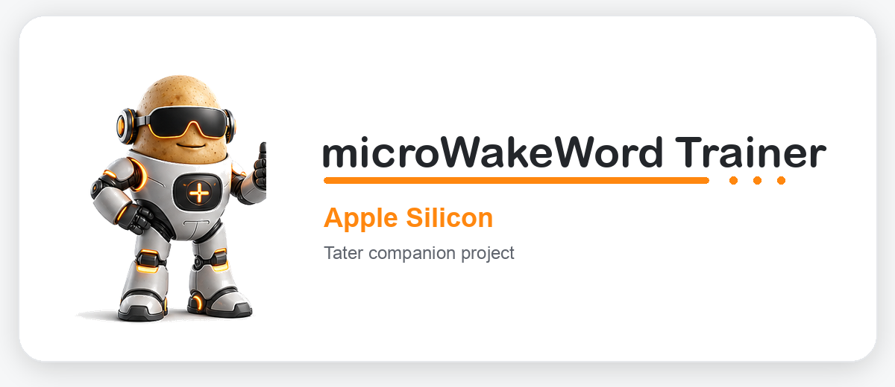

  

  <a href="https://taterassistant.com">taterassistant.com</a>

# Wake Word Trainer for Apple Silicon

Train custom **MicroWakeWord**, **openWakeWord**, and **NanoWakeWord CNN/GRU**
models on your Apple Silicon Mac, with a per-word **wake-boundary model**
for compatible satellites. Use the guided UI to add recordings, train, compare
versions, and copy the JSON links for your devices.

## Use your models with Tater or Home Assistant

Choose the satellite firmware for your hardware, then manage its wake words in
[Tater](https://github.com/TaterTotterson/Tater) or the
[Home Assistant Satellites bridge](https://github.com/TaterTotterson/Tater-Home-Assistant-Satellites).
The bridge connects compatible satellites directly to Home Assistant Assist;
the Tater app is optional for that setup.

| Satellite repo | Hardware | Wake detectors |
| --- | --- | --- |
| [Tater Native Firmware](https://github.com/TaterTotterson/Tater-Native-Firmware) | ESP32-S3: Voice PE, Satellite1, ReSpeaker XVF3800, S3 Box | MicroWakeWord |
| [Tater SAT1 RPi](https://github.com/TaterTotterson/Tater-SAT1-RPi) | Satellite1 HAT + Raspberry Pi | MWW, OWW, NWW CNN/GRU, and dual modes |
| [Tater Echo Firmware](https://github.com/TaterTotterson/Tater-Echo-Firmware) | Supported, unlocked Echo, Dot, Show, and Spot devices | MWW, OWW, NWW CNN/GRU, and dual modes |
| [Tater ThirdReality Voice Firmware](https://github.com/TaterTotterson/Tater-ThirdReality-Voice-Firmware) | ThirdReality Voice & Music Assistant (S420) | MWW, OWW, NWW CNN/GRU, and dual modes |

Check the firmware repo for supported hardware and installation instructions.
Browse ready-made models or request a word in
[Tater Wake Words](https://github.com/TaterTotterson/Tater-Wake-Words).

## Get started on Apple Silicon

1. [Download the latest macOS app](https://github.com/TaterTotterson/microWakeWord-Trainer-AppleSilicon/releases/latest).
2. Install and open **WakeWord Trainer**. The menu bar app keeps the trainer
   server available for satellite uploads.
3. Choose **Create a wake word**, or open a saved word for its results and JSON links.

You can also [run from source](docs/advanced.md#run-from-source). The web UI
normally opens at `http://127.0.0.1:8789`.

The first training run downloads models and datasets and can take extra time
and substantial disk space. Later runs reuse the cached files. To use an
external drive, choose **Data & storage → Change Folder…** or **Change Data
Folder…** from the menu bar. The app copies and verifies your data before switching.

## Choose what to train

Select one or more models during guided setup:

| Model | Use it for |
| --- | --- |
| **MicroWakeWord (MWW)** | ESP32-S3 satellites, ESPHome, or a shared model for a mixed-device setup. |
| **openWakeWord (OWW)** | An ONNX detector for compatible Echo and ThirdReality satellites. |
| **NanoWakeWord (NWW)** | A choice of CNN, GRU, or both architectures for compatible Echo and ThirdReality satellites. |
| **Wake boundary** | A companion model that locates the end of the wake phrase; trained with a full MWW run. |

On capable satellites, **MWW + OWW** and **MWW + NWW** require both detectors
to agree before opening a voice session. Train the matching models for the
policy you want. Include MWW when the same bundle will serve ESP32 satellites;
those devices use its MWW model. See the bridge's
[wake-word guide](https://github.com/TaterTotterson/Tater-Home-Assistant-Satellites/blob/main/docs/user-guide.md#configure-wake-words)
for model selection and fallback behavior.

## Train your first word

1. On **Start**, choose **Create a wake word** and enter the phrase and language.
2. Add personal recordings if you have them, or continue with generated speech.
   Personal samples are optional; reviewed false wakes help reduce unwanted triggers.
3. Choose the models to train. You can also enter similar-sounding phrases to reject.
4. Review the setup and start training. Progress and logs update live while you browse.
5. Open the word's **Results & JSON** page to review its quality report and copy its links.

For an existing phrase, open the saved word and choose **Train a new version**.
Each run keeps its own results and model files. You can compare versions, copy
an older version's JSON links, or choose **Use v… as current** to restore it.
To switch your satellites, apply the chosen version's JSON link in Tater or
the Home Assistant bridge.

## Put the word on your satellites

The two main links are on the word's **Results & JSON** page:

| Link | Where to use it |
| --- | --- |
| **Tater bundle JSON** (`.wake-bundle.json`) | Tater or the Home Assistant bridge. One package carries the available MWW, OWW, NWW models and wake-boundary metadata. |
| **ESPHome JSON** (`.esphome.json`) | An ESPHome `micro_wake_word` configuration. This link is MWW-only. |

In Tater or the bridge, choose the wake engine or dual mode you want and use
the custom bundle URL. Select CNN or GRU when using NanoWakeWord. Only engines
included in the bundle and supported by the satellite can be used.

Use the trainer's LAN address in **Trainer public URL**, for example
`http://192.168.1.50:8789`, so satellites can download the models. Keep the
trainer reachable, or host the JSON and all referenced model files at URLs
your satellites can reach.
Version-specific links stay tied to that saved run; the current publication
follows whichever version you select as current.

## What the wake-boundary model does

The wake detector recognizes the phrase. The **wake-boundary model** locates
where that phrase ends in the audio. For “hey tater turn on the lights,” it
helps keep “turn on the lights” intact when removing “hey tater” before speech
recognition. All Tater satellite firmware uses this model to preserve commands
spoken immediately after the wake phrase.

- A full **MicroWakeWord** run trains and calibrates a separate boundary model
  for that word, with its own threshold separate from wake-detection sensitivity.
- The `.boundary.tflite` file and its settings travel in **Tater bundle JSON**;
  there is no separate download step for users of the bundle.
- Compatible firmware can use the same boundary model with MWW, OWW, NWW,
  **MWW + OWW**, or **MWW + NWW** detection.
- To update only the boundary later, use **Additional training actions →
  Retrain boundary only**. This requires the retained data/config from a full
  MWW run and keeps the detector models intact.

The separate ESPHome JSON link remains an MWW detector manifest.

## Improve the word with real recordings

In Tater or the Home Assistant bridge, enable satellite wake/close-miss audio
capture and set **Trainer App URL** to the trainer's LAN address. Keep the
trainer running while you collect clips. **Audio uploads do not require the
optional auto-training link.**

In **Captures**, play the clips and check which word they belong to:

- **Add positive** keeps a good example of the phrase.
- **Mark negative** keeps a false trigger as a phrase the model should reject.
- **Discard** removes an unwanted clip.

Use **Samples** to import audio, trim clips, restore their originals, or remove
samples. **Auto training** can transcribe captures and retrain on a schedule.
Pair the optional **Auto-training link** only if you want new models published
back to Tater or the bridge automatically. The bridge's
[trainer-link guide](https://github.com/TaterTotterson/Tater-Home-Assistant-Satellites/blob/main/docs/user-guide.md#link-the-wake-word-trainer)
explains pairing and how publishing changes the shared wake profile.

## Your data and more help

The default data folder is `~/.taterwakewordtrainer/app/current`; use the app
to move it to an external drive. Updates retain your recordings and saved words.

Use **Data & storage** to inspect disk use and remove selected caches. Saved
versions and recordings are separate from rebuildable training data; read each
category before deleting it.

- [Advanced guide](docs/advanced.md) — source setup, sample formats, Auto Training rules, languages, model files, and development.
- [Issue watcher guide](docs/watcher.md) — dedicated training Macs, multi-Mac claims, recovery, and cleanup after publication.
- [What's New](WHATS_NEW.md) and [releases](https://github.com/TaterTotterson/microWakeWord-Trainer-AppleSilicon/releases).
- [Home Assistant wake-word setup](https://github.com/TaterTotterson/Tater-Home-Assistant-Satellites/blob/main/docs/user-guide.md#configure-wake-words).
- [Credits](docs/advanced.md#credits).
